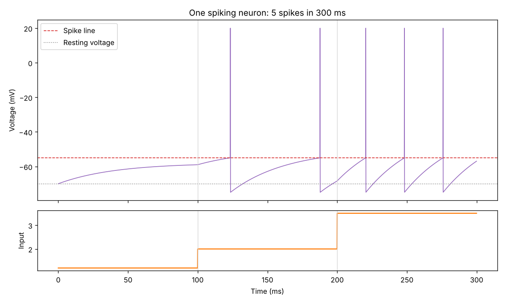

# Neuromorphic experiments

Small experiments in brain-inspired computing: why does the brain run on about 20 watts while AI needs data centers?

## Build #1: one spiking neuron

`neuron.py` simulates a single **leaky integrate-and-fire (LIF) neuron**, the simplest model of a brain cell.

Think of it as a leaky bucket: input current fills it up, it slowly leaks, and when the level hits a threshold the neuron **spikes** and resets.



### Run it

```
pip3 install numpy matplotlib
python3 neuron.py
```

### What I found

The input steps from weak to medium to strong. Changing `tau` (the neuron's time constant, or reaction speed):

| tau (ms) | Weak | Medium | Strong | Total spikes |
|---|---|---|---|---|
| 5 | 0 | 13 | 28 | 41 |
| 10 | 0 | 6 | 15 | 21 |
| 20 | 0 | 3 | 8 | 11 |
| 40 | 0 | 2 | 3 | 5 |

- **Bigger tau, fewer spikes.** A slower neuron takes longer to climb back to the threshold after each spike, so it fires less, and uses less energy.
- **Weak input never spikes, whatever tau is.** Tau controls the neuron's *speed*, not its *sensitivity*. The voltage settles just below the threshold and stays there.
- A real neuron mostly spends energy when it spikes. My computer updated the neuron 3,000 times to produce 21 spikes. Brain-like (neuromorphic) chips aim to only spend energy on the spikes.

## Next

- Build #2: a normal network vs. a spiking network on handwritten digits (snnTorch), comparing accuracy and how much work each does.
